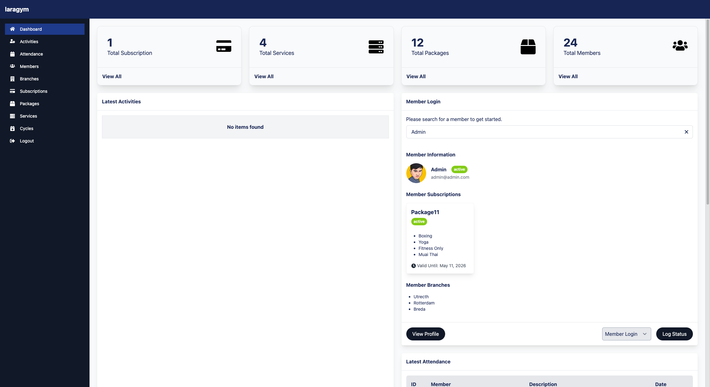
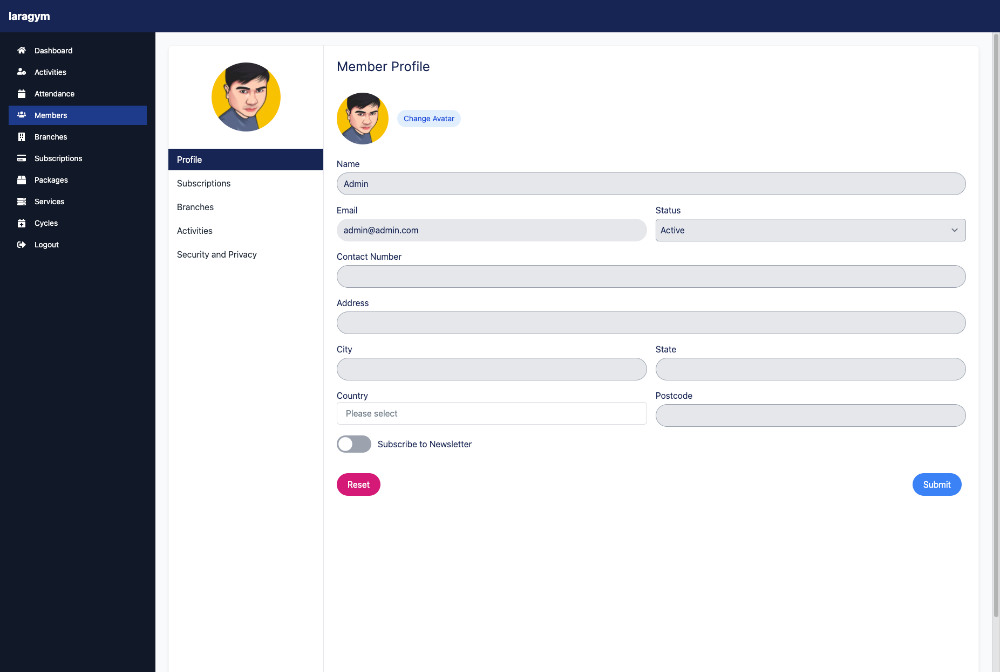
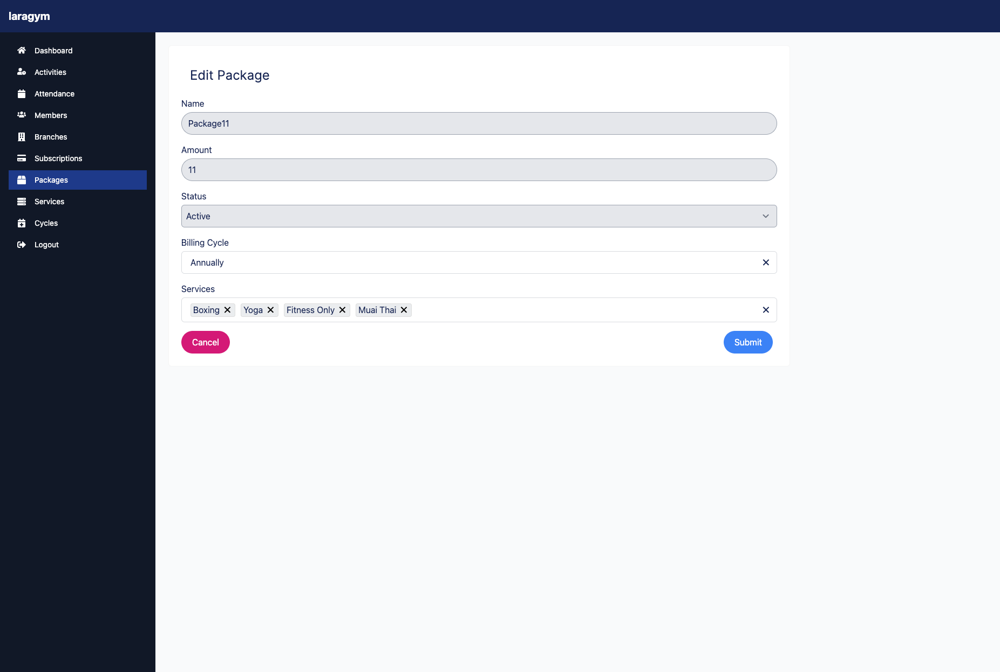

# Aura Pilates

A studio management system built with Laravel (REST API), a SvelteKit admin panel, and a mobile-friendly member PWA. Based on [LaraGym](https://github.com/johndavedecano/laragym).



## Features

- **Packages** — create and manage membership packages with billing cycles
- **Members** — user management with profiles and account numbers
- **Services & billing cycles** — annually, weekly, daily, fixed, and more
- **Attendance** — track member check-ins per branch
- **Subscriptions** — manage member subscriptions with status tracking
- **Branches** — multi-branch support
- **Activity logs** — system-wide audit trail
- **Admin panel** — SvelteKit dashboard for staff (port 5173)
- **Member PWA** — installable progressive web app for members (port 5174)

See [MILESTONE.md](MILESTONE.md) for the roadmap.

## Tech stack

| Part | Stack |
|---|---|
| API | Laravel 9, Sanctum (bearer tokens), spatie/laravel-query-builder, MySQL 8 |
| Admin panel | SvelteKit 2, Svelte 5, Skeleton UI, Tailwind CSS 3 |
| Member PWA | SvelteKit 2, Svelte 5, Skeleton UI, Tailwind CSS 3, vite-plugin-pwa |
| Dev services (Docker) | PHP 8.4, MySQL 8.0, Redis, MailHog |

## Project structure

```
aura-pilates/
├── app/                        # Laravel application (controllers in app/Http/Controllers/Api)
├── routes/api.php              # REST API routes
├── database/                   # migrations, factories, seeders
├── tests/Feature/              # API feature tests (PHPUnit)
├── resources/apps/
│   ├── admin/                  # Admin panel (SvelteKit)
│   └── member/                 # Member PWA (SvelteKit + vite-plugin-pwa)
├── docker/                     # PHP image + MySQL init scripts
└── docker-compose.yml          # app, mysql, redis, mailhog
```

## Getting started

### 1. Laravel API with Docker (recommended)

Requirements: Docker with Compose v2.

```bash
cp .env.example .env
docker compose up -d --build                      # first boot runs composer install (takes a minute)
docker compose exec app php artisan key:generate
docker compose exec app php artisan storage:link
docker compose exec app php artisan migrate --seed
```

| Service | URL |
|---|---|
| API | http://localhost:8000/api |
| MailHog (captured emails) | http://localhost:8025 |
| MySQL | `localhost:3306`, user `root`, password = `DB_PASSWORD` in `.env` (empty by default) |
| Redis | `localhost:6379` |

Seeded admin account: `admin@admin.com` / `password`.

Run any PHP command inside the container:

```bash
docker compose exec app php artisan <command>
docker compose exec app composer <command>
docker compose logs -f app                        # API logs
docker compose down                               # stop (MySQL data is kept in storage/mysql)
```

Notes:

- The same `.env` works for Docker and host-run PHP: `docker-compose.yml` points `DB_HOST`, `REDIS_HOST` and `MAIL_HOST` at the containers for the `app` service.
- On Linux, build with your user ID so files created in the container belong to you: `UID=$(id -u) GID=$(id -g) docker compose build`.
- The image uses PHP 8.4 because `composer.lock` requires it.
- Ports 8000, 3306, 6379, 1025 and 8025 must be free on the host.

### 1b. Laravel API without Docker

Requires PHP 8.4 (with `pdo_mysql`, `gd`, `zip`), Composer and MySQL 8.

```bash
composer install
cp .env.example .env        # set your DB credentials
php artisan key:generate
php artisan storage:link
php artisan migrate --seed
php artisan serve           # http://localhost:8000
```

### 2. Admin panel

```bash
cd resources/apps/admin
cp .env.example .env        # PUBLIC_API_URL=http://localhost:8000
npm install
npm run dev                 # http://localhost:5173
```

### 3. Member PWA

```bash
cd resources/apps/member
cp .env.example .env        # VITE_API_BASE_URL can stay empty in dev (proxy handles it)
npm install
npm run dev                 # http://localhost:5174
```

> In development the member app proxies all `/api` requests to `http://localhost:8000`. For production set `VITE_API_BASE_URL` to the API's public URL.

## API

The REST API is served at `http://localhost:8000/api`. Authenticate with `Authorization: Bearer <token>` from `POST /api/auth/login`.

| Group | Endpoints |
|---|---|
| Auth | `POST /api/auth/login`, `register`, `logout`, `refresh`, `forgot`, `reset`, `verify/{id}/{hash}`, `resend` |
| Member (auth) | `GET/PUT /api/me`, `PUT /api/me/password`, `GET /api/me/subscriptions`, `GET /api/me/attendance`, `GET /api/branches` |
| Admin only | `cycles`, `services`, `branches`, `packages`, `subscriptions`, `users`, `users/{user}/branches`, `users/{user}/avatar`, `activities`, `stats/*` |

## Tests

Tests run against a MySQL database named `testing` (see `phpunit.xml`). With Docker it is created automatically the first time MySQL initialises:

```bash
docker compose exec app ./vendor/bin/phpunit
```

If your `storage/mysql` data dir existed before, create it once:

```bash
docker compose exec mysql mysql -uroot -e 'CREATE DATABASE IF NOT EXISTS testing'
```

Without Docker, create a `testing` database on your MySQL server and run `./vendor/bin/phpunit`.

Admin panel tests: `cd resources/apps/admin && npm run test`.

## Working with AI agents

[AGENTS.md](AGENTS.md) describes the architecture, conventions and verification commands for AI coding agents.

## Screenshots




## License

MIT. Based on LaraGym by John Dave Decano.
